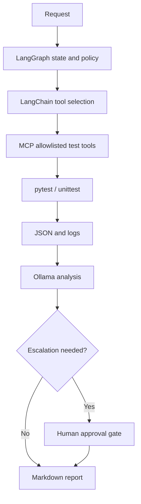

# AI-driven CI/CT — LangChain / LangGraph Multi-Agent Experiment

> Baseline specification on `main`. The two experiment branches are independently derived from `main`; neither branch is the source of truth for acceptance criteria.

## 1. Branch and agent configuration

| Branch | Agent | Model | Primary objective | Scope |
|---|---|---|---|---|
| `main` | Human-reviewed baseline | — | Maintain requirements, test definitions and acceptance criteria | Documentation and approved baseline |
| `experiment/agent-ci-ct` | Agent 1 — CI/CT | GPT-6 Luna (High) | Use LangChain tools to select, execute and analyze deterministic pytest/unittest tests | LangChain, GitHub Actions, pytest/unittest, reports |
| `experiment/agent-mcp` | Agent 2 — LangGraph orchestration | GPT-6 Luna (High) | Control agent state, branching, retry and human approval around MCP tests | LangGraph, MCP server, Ollama/escalation |

Both agents start from the same baseline. Their work is reviewed through separate pull requests; no automatic merge to `main`. The existing branch name `experiment/agent-mcp` is retained, although Agent 2 now also evaluates LangGraph orchestration.

### Framework responsibilities

| Component | Responsibility | Status |
|---|---|---|
| `pytest` / `unittest` | Deterministic test execution and assertions | Existing |
| `LangChain` | LLM/tool adapters, tool selection, structured inputs and outputs | Proposed experiment |
| `LangGraph` | Explicit state graph, conditional transitions, retry/checkpoints and human approval | Proposed experiment |
| MCP `stdio` server | Restrict callable external test operations to the allowlist | Existing |
| Ollama | Local LLM for analysis of pytest results | Existing |
| Codex / Codex Cloud | Comparison Agent/harness, not a prerequisite for LangChain or LangGraph | Optional comparison |

**Design goal:** Test whether LangChain + LangGraph add useful controllability to the existing pytest/unittest automation. Do not equate a framework with the underlying test runner or its authorization policy.

## 2. Baseline system

- Runtime: Python project-local `.venv`.
- Tests: `unittest` and `pytest`, with CT fixture modes `marker`, `mock`, `hil`.
- Analysis: Ollama handles pytest-result analysis; unittest does not require Ollama.
- Reporting: normalized JSON/logs, Markdown, optional MkDocs/Pandoc.
- Control: GitHub Actions and local `stdio` MCP server.
- Experimental Agent layer: LangChain for tools/model invocation, LangGraph for stateful control flow. Neither is currently assumed to be implemented.
- Agent 1 is the test-operation specialist; Agent 2 is the stateful coordinator. Compare independent operation before attempting coordination.
- Cloud limitation: Codex Cloud does **not** automatically inherit a user's local Ollama server, Jetson hardware, or local MCP process. Those integrations require separately configured access and authorization.

## 3. Existing CT test inventory

The following TEST IDs are registered in `test_envs/tests/pytest/test_cases/test_catalog.json`.

| TEST ID | Category | Existing test file | Test purpose | First-run fixture |
|---|---|---|---|---|
| `CT-UART-001` | Timing | `test_fixture_001_uart_timing.py` | Exercise UART timing CT path and result recording | Mock |
| `CT-USB-001` | Communication | `test_fixture_002_usb_loopback.py` | Exercise USB loopback CT path and result recording | Mock |
| `CT-NETWORK-001` | Communication | `test_fixture_003_network_loopback.py` | Exercise network loopback CT path and result recording | Mock |

The descriptions above are experiment-level purposes derived from the registered test names; exact assertions and timing thresholds must be checked against each implementation before changing acceptance limits. The first experiment must not invoke real equipment.

## 4. Agent 1 — LangChain-based CI/CT test specification

**Purpose:** Prove that baseline test discovery, deterministic execution and reporting work without Agent-dependent pass/fail criteria.

| Test ID | Test objective | Procedure | Pass criterion |
|---|---|---|---|
| `AG1-001` | Baseline inventory | Inspect pytest catalog and unittest targets | Expected registered cases are found; no generated files altered |
| `AG1-002` | Safe unittest execution | Run `python -m pytest -p no:cacheprovider test_envs/tests/unittest/ct_framework/python -q` in an isolated environment | Exit code 0; failures/logs, if any, accurately reported |
| `AG1-003` | UART CT mock | Execute `CT-UART-001` with `fixture_mode=mock` | Result contains test ID, status, execution ID and logs |
| `AG1-004` | USB CT mock | Execute `CT-USB-001` with `fixture_mode=mock` | Same normalized result contract |
| `AG1-005` | Network CT mock | Execute `CT-NETWORK-001` with `fixture_mode=mock` | Same normalized result contract |
| `AG1-006` | Failure reporting | Reproduce a controlled negative case in mock/isolation | Failure is not reclassified as pass; Markdown agrees with JSON |
| `AG1-007` | GitHub workflow isolation | Review issue/manual triggers, token permissions and self-hosted runner selection | Untrusted issue inputs cannot cause privileged code execution; any risk is documented and fixed before enabling unattended runs |
| `AG1-008` | LangChain tool integration | Wrap allowlisted inventory and mock CT operations as LangChain tools with explicit input schema | Agent invokes only permitted tools; invalid arguments rejected; test PASS/FAIL unchanged |
| `AG1-009` | LangChain model comparison | Run the same normalized mock result through existing Ollama analysis and LangChain tool-driven analysis | Outputs recorded separately; evidence and usage compared without changing the canonical test status |

**Boundary:** No HIL, equipment access, source auto-fix, arbitrary checkout ref execution, or privileged token use without separate review.

## 5. Agent 2 — LangGraph / MCP orchestration test specification

**Purpose:** Verify that a LangGraph-controlled Agent can use the existing allowlisted MCP tools, preserve explicit state, branch on outcomes and resume only with appropriate approval.

| Test ID | Test objective | Procedure | Pass criterion |
|---|---|---|---|
| `AG2-001` | MCP protocol contract | Execute existing `test_mcp_runner.py` contract tests excluding `stdio` | Test assertions pass |
| `AG2-002` | Local stdio integration | Run `test_mcp_runner.py -k stdio` only in a prepared local environment with `AI_CT_RUN_STDIO_TEST=true` | MCP subprocess starts and communicates correctly |
| `AG2-003` | Tool discovery | Enumerate tools and invoke `get_test_envs`, `get_test_list_all` | Only documented allowlisted tools exposed; schema/outputs valid |
| `AG2-004` | Controlled mock execution | Call `run_test_pytest` for one known TEST ID with `fixture_mode=mock` | Test ID, execution ID, status and result/report path returned |
| `AG2-005` | Permission enforcement | Attempt disallowed HIL/MkDocs operation with `PYTEST_HIL_ALLOW=false`, `MKDOC_UPDATE=false` | Request blocked and no external device or docs mutated |
| `AG2-006` | Ollama fallback | Simulate unavailable/invalid Ollama response during a pytest analysis | Deterministic fallback/error handling; no fabricated success |
| `AG2-007` | Escalation boundary | Produce controlled failure and inspect `codex_escalation` decision | Escalation becomes recommendation only; no unauthorized fix, push or HIL action |
| `AG2-008` | LangGraph state transitions | Model `DISCOVER → VALIDATE → RUN_MOCK → ANALYZE → REPORT` with failure branches | Every transition and result is recorded; failed validation blocks execution |
| `AG2-009` | Checkpoint and resume | Interrupt at a controlled state, persist an execution ID/checkpoint and resume | No duplicate hardware action/test invocation; previous state recovered correctly |
| `AG2-010` | Human approval branch | Trigger escalation requiring HIL or source modification | Graph pauses at approval gate; denial performs no privileged action |
| `AG2-011` | LangChain vs LangGraph comparison | Run same mock scenario via LangChain-only tools and LangGraph orchestration | Compare steps, failures, recovery, usage and complexity using identical assertions |

**Boundary:** MCP server is an execution interface, not an authorization bypass. Codex Cloud-to-local-MCP connectivity is a separate integration milestone and must not be assumed.

## 6. Target orchestration flow

This is a **proposed**, not yet deployed architecture. The runner owns test truth; neither LangChain nor LangGraph may override assertion results. LangGraph checkpointing needs a defined durable store and deduplication policy before enabling any side-effectful resume.

## 7. Execution sequence

1. **Design baseline:** Maintain this file on `main`, covering LangChain, LangGraph and existing pytest/unittest.
2. **Read-only review:** Each Agent inspects its assigned subsystem.
3. **Environment check:** Record Python, dependency and available-tool status.
4. **Unit/contract tests:** Run safe tests without hardware, then independently implement LangChain tool binding and LangGraph state transitions.
5. **Mock CT:** Run the three registered test cases, then one controlled failure.
6. **Security check:** Verify ref selection, token permissions, HIL gating and write boundaries.
7. **Report:** Each Agent provides results and evidence on its own branch/PR.
8. **Human review:** Compare outcomes and selectively merge approved changes.

## 8. Shared report and acceptance criteria

| Field | Required |
|---|---|
| Agent/model/reasoning | Yes |
| Framework and version (`LangChain`, `LangGraph`, MCP) | If used |
| Graph state, transition and checkpoint ID | For LangGraph runs |
| Branch and commit SHA | Yes |
| Test ID and execution ID | Yes |
| Environment (local/cloud, OS, Python) | Yes |
| Command or MCP tool with parameters | Yes |
| Status and exit code | Yes |
| Log and normalized JSON locations | Where produced |
| Duration and resource/usage data | When available; never invent |
| Root cause and evidence | For failures |
| Source changes / diff | If modified |
| Explicit limitations and unverified assumptions | Yes |

A test is `PASS` only when its defined assertions and expected effects are verified. Agent explanation alone is not a pass criterion. No PR is merged automatically.

## 9. Source references

- [Architecture](../DESIGN.md)
- [Continuous-test workflow](../.github/workflows/continuous-test.yml)
- [MCP operations](mcp_environment.md)
- [Pytest framework](pytest_framework.md)
- [Unittest framework](unittest_framework.md)
- [Registered pytest catalog](../test_envs/tests/pytest/test_cases/test_catalog.json)
